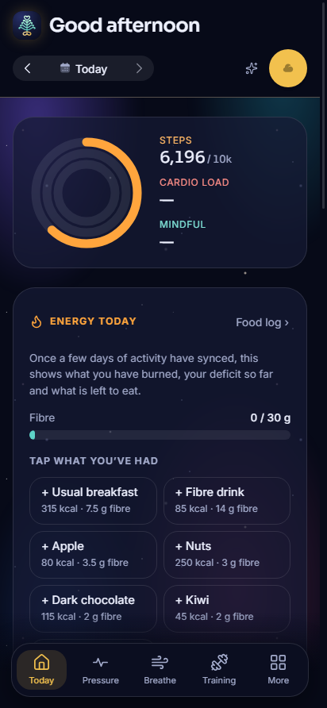
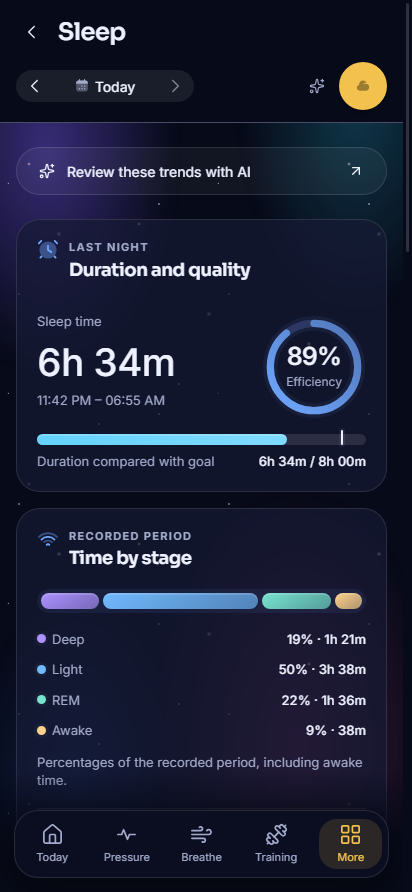
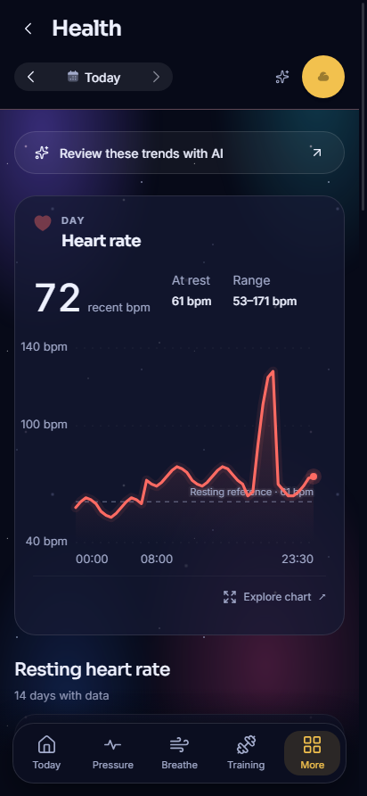
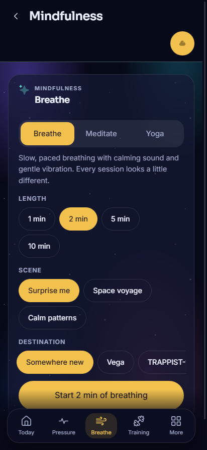
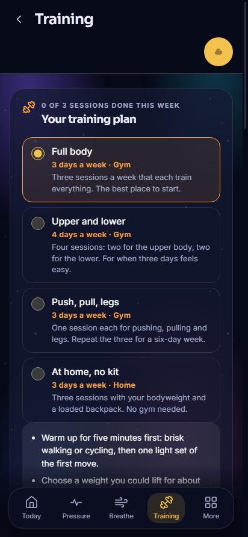
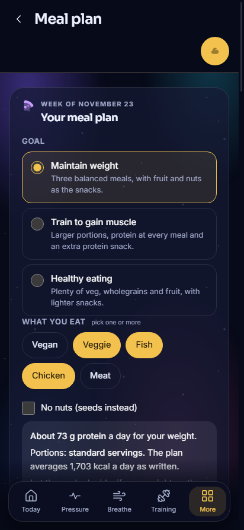

# OpenFit

A free Android app for getting more out of your Fitbit data. It reads from **Health Connect**, so if the Google Health (Fitbit) app syncs there, OpenFit can show it.

No ads, no account, no OpenFit server. Your data stays on your phone.

## Download

Get the latest APK from **[Releases](https://github.com/lex624/openfit-releases/releases/latest)**.

## Screenshots

Shown with the app's built-in sample data.

| Today | Sleep | Heart |
|---|---|---|
|  |  |  |

| Breathe | Training | Meal plan |
|---|---|---|
|  |  |  |

## What it does

- **Sleep:** stages, heart rate and optional on-device snore detection on one night timeline, with a review against your own usual nights
- **Trends:** steps, resting heart rate, HRV, respiratory rate and skin temperature, compared with your own normal
- **Fitbit Air wrist alerts:** choose which apps buzz your wrist, with different vibration patterns for calls, messages and more
- **Everyday tools:** hourly move reminder, after-meal walk timer, guided breathing, meditation and yoga, HIIT and gym plans, food log and meal planner

## Install

1. Download `OpenFit-x.y.z.apk` from the latest release on your Android phone.
2. Open it and allow installing from your browser or file manager when Android asks.
3. In the Google Health (Fitbit) app, turn on syncing to Health Connect.
4. Open OpenFit, go to **More → Data & reminders**, connect, and grant the Health Connect permissions you want.

Which metrics appear depends on what your tracker's app writes to Health Connect.

Updates install over the top of the previous version, keeping your data.

## Good to know

- OpenFit is **not a medical device**. It shows wellness trends, not diagnoses. Talk to a healthcare professional about medical questions.
- Fitbit Air wrist alerts use an unofficial connection that a firmware update could break. OpenFit is not affiliated with or endorsed by Google or Fitbit.
- Privacy: see [PRIVACY.md](PRIVACY.md).
- Support: j.more.ljb@gmail.com

## Support the project

OpenFit is free. If it helps you, you can [buy me a coffee on PayPal](https://www.paypal.com/paypalme/mistyaddai).
